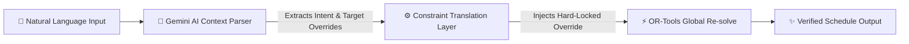

# I Built an AI-Powered Timetable Optimizer to Replace My Mom’s Ancient Scheduling Software

> Using Google OR-Tools CP-SAT and Gemini AI to solve an NP-hard scheduling problem with a neuro-symbolic twist.


Every academic year, administrators across the world sit down to face one of computer science’s most classic optimization puzzles: **School Timetabling**. 

My toughest evaluator isn't a continuous integration suite or an industry-standard benchmark dataset. **It’s my mother.** As a veteran educator and schedule coordinator, she has spent years wrestling with outdated, clunky timetable software. Every summer involves long evenings of trial-and-error manually swapping slots by hand to ensure zero resource overlap while balancing teacher preferences. 

Watching her manually run a human simulated annealing algorithm inspired me to build a modern replacement. But instead of settling for a simple heuristic search, I wanted to build an **End-to-End fullstack platform** combining rock-solid mathematical determinism with next-generation natural language capabilities.

Here is how I designed the **Timetable Manager**, combining **Google OR-Tools CP-SAT** for constraint programming with **Google Gemini AI** for ad-hoc schedule translation.

---

## The NP-Hard Problem of Timetabling

At its core, scheduling classes maps multi-dimensional variables — Teachers ($T$), Subjects ($S$), Student Class Groups ($C$), Rooms ($R$), Days ($D$), and Periods ($P$). 

A valid timetable must strictly satisfy multiple non-negotiable **Hard Constraints**:
1. **No Teacher Clashes**: A teacher cannot be in two places at once.
2. **No Class Clashes**: A student group can only attend one lecture per period.
3. **Room Exclusivity**: A room can host exactly one assignment per timeslot.
4. **Mandatory Coverage**: Each subject must meet its exact required weekly allotment.
5. **Specialized Allocation**: Physics, Chemistry, and CS labs must occur in designated lab rooms.

If you scale this across 30+ teachers and dozens of classes, the permutation space explodes exponentially. Pure Large Language Models (LLMs) struggle immensely with strict combinatorial constraints, frequently hallucinating assignments that silently cause resource overlaps. 

To solve this reliably, we need a **Neuro-Symbolic architecture**.

---

## The Engine: Google OR-Tools CP-SAT

Instead of writing custom genetic algorithms from scratch, I leveraged the industry-standard **Google OR-Tools CP-SAT solver**. 

Using Python, we map each multi-dimensional combination as a Boolean decision variable:

```python
x[(t_id, s_id, c_id, r_id, d, p)] = model.NewBoolVar(f"x_{t_id}_{s_id}_{c_id}_{r_id}_{d}_{p}")
```

We then programmatically inject constraints directly into the SAT model. For instance, ensuring no teacher clash takes a single elegant summation rule:

```python
for t in teachers:
    for d in days:
        for p in range(1, periods_per_day + 1):
            model.Add(
                sum(
                    x[(t["id"], s_id, c["id"], r["id"], d, p)]
                    for s_id in t["qualified_subjects"]
                    for c in classes if s_id in c["subject_ids"]
                    for r in rooms
                    if (t["id"], s_id, c["id"], r["id"], d, p) in x
                ) <= 1
            )
```

The CP-SAT solver optimizes globally, exploring millions of states per second to return a fully clash-free, mathematically verified schedule in under 5 seconds.

---

## The Magic: Neuro-Symbolic AI Translation

What happens when a teacher approaches the administration mid-semester with an ad-hoc request? 

> *"Can we move Mrs. Sharma’s Physics lecture from Monday 3rd period to Wednesday 1st period?"*

In traditional software, making this change manually breaks surrounding allocations, forcing the coordinator to cascade adjustments by hand. 

In our solution, the user simply types this natural language request into the **Gemini AI Timetable Assistant drawer**. 



1. **Intelligent Parsing**: Gemini parses the conversational intent, extracting specific entities (`target_teacher`, `target_subject`, `new_day`, `new_period`).
2. **Translation Layer**: Instead of letting Gemini generate the timetable text directly, our Python middleware intercepts the payload and injects a **hard-locked constraint** into the CP-SAT solver matching the requested override.
3. **Global Re-solve**: The solver runs again with the new locked condition. It automatically shuffles surrounding non-locked assignments to seamlessly accommodate the request without breaking global consistency.

---

## Designing for Visual Excellence

To make this completely accessible, I built a bespoke **Dark Mode user interface** using Vanilla CSS Grid and standard Web Components communicating with the FastAPI backend.

Features built specifically for my mom's operational workflow include:
- **Instant Printable Grids**: Clean tabs switching instantly between **Class-Wise schedules** (to pin on classroom bulletin boards) and **Teacher-Wise schedules** (for staff members).
- **Responsive Printing Media Queries**: Specialized `@media print` CSS token layers that automatically strip away dark-mode textures, banners, and sidebar controls, rendering crisp high-contrast black-and-white grids optimized perfectly for single A4 sheets.
- **Visual Subject Color Coding**: Custom pastel visual tokens instantly communicating subject categories at a glance.

---

## Conclusion & What I Learned

Building an application end-to-end for a real-world user uncovers unique technical constraints. Combining pure mathematical optimization with generative AI interfaces offers the best of both worlds: **uncompromising determinism paired with beautiful natural usability.**

If your mom is still manually mapping schedules on scratchpads or legacy software, give her a break. Spin up the code, plug in your Gemini API key, and let optimization do the heavy lifting!

---
*Check out the open-source repository on GitHub to deploy your own high-performance school scheduling cluster.*
